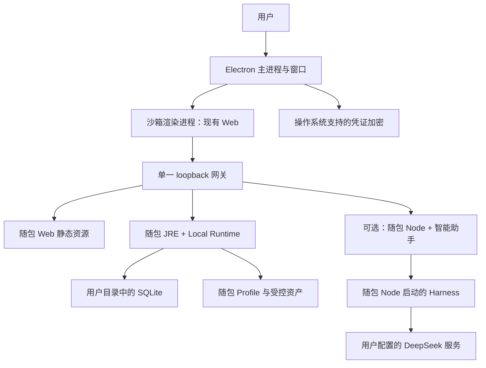

# OPM macOS / Windows 桌面客户端设计

版本：0.2；日期：2026-11-16；状态：开发态已实现，验证进展见[实现清单](../checklists/opm-desktop-client-implementation-feature-checklist.md)；安装包与跨平台发布验收待执行。

需求见[桌面增量需求](../requirements/opm-desktop-client-requirements.md)，实现范围与验收见[实现规格](../specs/opm-desktop-client-implementation-feature-spec.md)。本文是原[架构](opm-modeling-tool-architecture.md)允许的桌面壳扩展，不修改既有领域契约或冻结状态。开发与构建命令见[桌面工程说明](../../apps/desktop/README.md)。

## 1. 当前实现事实与缺口

| 当前证据 | 已有能力 | 桌面缺口 |
| --- | --- | --- |
| `apps/web`、`apps/desktop` | 复用 Vue/TypeScript/X6，桌面提供已构建 Web、同源网关及退出保存桥 | 不依赖 Vite；安装包中的实际资源和干净环境仍须验收 |
| `services/local-runtime`、根 `pom.xml` | Spring Boot 后端；当前 Java 编译级别 17，Maven 要求 JDK 17+ | 要按每种 OS/CPU 随包提供已验证 JRE；旧技术文档 Java 21 与代码有差异，不能直接当作当前事实 |
| `StorageConfiguration`、`SqliteStore` | 本仓库仅 SQLite，目录库 `catalog.db`、每项目 `projects/<projectId>/project.db`，Flyway、WAL、外键和锁等待；桌面已接入独立数据根、工作区锁和停服备份 | 真实安装升级、强停、磁盘不足及目标平台矩阵仍需验收 |
| `LocalRuntimeBootstrapController` | loopback `/opm-bootstrap.js` 提供本地会话及 Profile 绑定 | 新的桌面 origin 必须通过既有校验，不绕过本地会话 |
| `apps/assistant/src/server.mjs` | 独立 Node HTTP 服务，配置 Key 后可运行；现有 `/health` | 无 Key 时配置校验失败，桌面必须把 AI 作为可选服务；不能让助手失败阻断核心启动 |
| `apps/assistant/src/harness.mjs` 和已安装 SDK | 项目级 Harness 工作区、受限工具、独立 session；SDK 当前用 `process.execPath` 启动子进程 | 助手需用随包的真实 Node 运行；直接用 Electron 可执行文件替代 Node 尚未验证，不作为首版方案 |

助手监听后已使用实际端口更新 `toolOrigin`。桌面专用入口不读取开发 `.env`，通过 ready 文件和 stdin 监护与主进程协调。

## 2. 选型与增量决策

首版使用 Electron 45.3.2 + Electron Forge 8.0.1，工程需要 Node 22.13+。目标 macOS 13+ 与 Windows 11 x64；Electron 分发包声明 macOS 下限 13.0，最低系统及全部架构仍须实际验收。

| 方案 | 适用性与代价 | 决策 |
| --- | --- | --- |
| Electron | 复用现有 Vue/X6；随包 Chromium 使画布及浏览器 API 验收环境一致；有 Node 进程管理能力，但安装体积和内存需要实测 | 首版已采用 |
| Tauri | 可通过 sidecar 打包外置服务；仍需打包 Java、助手 Node 与原生依赖，并验证不同系统 WebView 的画布表现；新增 Rust 工具链 | 后续有测量依据再评估 |
| 本地服务 + 系统浏览器 | 复用既有架构，但窗口生命周期和使用入口仍依赖外部浏览器 | 保留已有模式，不作为新客户端交付 |

增量 ADR-DESKTOP-001：桌面壳只拥有窗口、受管进程、系统文件选择、凭证和分发；业务命令仍通过现有 Runtime。桌面工程不复制 OPM、OPL、校验、草稿或 SQLite 逻辑。

增量 ADR-DESKTOP-002：客户端使用单一 loopback 网关提供打包后的 Web 与代理。它是桌面传输适配层，不是新增业务后端。此拓扑仅用于桌面模式，与旧基线的“Runtime 提供静态 Web”存在运行形态差异；实施规格须明确该增量，原 Web/K8s 部署不跟随变更。

## 3. 目标拓扑与工程边界



窗口只加载 `http://127.0.0.1:<gatewayPort>/projects`。核心使用不需要用户看到端口，也不需要设置环境变量或打开终端。

桌面工程位于 `apps/desktop`：`src/main.mjs` 管窗口、菜单与 IPC，`runtime.mjs` 管受管服务，`gateway.mjs` 管同源代理，`preload.cjs` 提供固定动作，`scripts/prepare-resources.mjs` 与 Forge 配置管理资源和构建。Java/助手仍保留现有业务实现。

资源与可写目录严格分离。安装资源含 `web/`、`runtime/local-runtime.jar`、`jre/`、`node/`、`assistant/`、`profiles/`；可执行文件和需实体路径的 Node 模块放到可实际读取的资源目录，不能假定 ASAR 内路径可以被 Java、SQLite JNI 或子进程当普通磁盘文件使用。

## 4. 同源网关与启动握手

| 浏览器请求 | 桌面网关处理 |
| --- | --- |
| `/`、`/projects`、应用内路由和静态资源 | 提供构建后的 Web；仅已知页面路由允许 SPA fallback，缺失 API/资源返回真实错误 |
| `/opm-bootstrap.js` | 代理 Runtime，保持 no-store 与会话绑定 |
| `/api/v1`、`/api/v2` 及事件请求 | 透明代理 Runtime，保留幂等 ID、DraftToken、状态码、错误体和取消语义 |
| `/api/assistant` | 配置 AI 后代理助手；未配置时返回明确不可用状态，前端引导设置；不影响其他 API |

代理必须支持 POST SSE、流式 flush、断连及长任务；不能缓存事件、将 SSE 合并成整段响应或重写业务错误为成功。Host/Origin 只按固定已知链路处理，精确配置网关 origin，保留 `X-OPM-Session`，不启用通配 CORS。

网关首次绑定 `127.0.0.1:0`，把实际端口存入用户目录 `local-origin.json`，后续重开使用相同 origin，保证 Chromium IndexedDB 中待确认请求与恢复输入可达。冲突时明确失败，不擅自换端口或结束其他服务。Java 和助手每次仍监听 loopback 随机端口。ready 协议 v1 包含协议版本、组件、实际端口、PID 和 nonce；二进制/资源版本由资源清单核对。父进程核对身份后再探测健康，不能复用旧回执或只探测端口。

Runtime 就绪应包含存储初始化与必需 Profile 检查，`/health` 或 liveness 成功本身不证明所有业务能力就绪。助手监听成功后才能确定内部 `toolOrigin`，必须先修复该适配再启用随机端口。

## 5. 生命周期与异常处理

状态：`STARTING → CORE_READY → RUNNING → STOPPING → STOPPED`；核心失败进入 `FAILED`，AI 独立为 `UNCONFIGURED / STARTING / READY / FAILED`。启动页显示正在检查数据、启动本地服务或加载工作台，失败可查看原因并重试。

1. 主进程获取单实例锁及数据目录跨进程锁；不能仅依赖不同安装路径下的窗口锁。失败时聚焦原实例或明确提示目录正在使用，不杀占用端口的其他进程。
2. 检查随包资源和数据版本，创建日志及本次 ready 目录，启动网关与 Runtime。核心就绪后开放工作台；只有配置有效凭证才启动 AI。
3. 每个子进程记录所有权、PID、启动 nonce 和退出状态。核心意外退出时停止写入，保留前端恢复信息并提供重启；AI 退出只暂停助手，保留本地画布与会话。
4. `before-quit` 进入退出协调，前端报告未保存编辑、上传和提案状态；先通过现有草稿流程保存编辑，或让用户明确选择放弃/取消退出。未确认 AI 提案只保留会话，不自动应用到正式模型。
5. 停止新的写请求、停止/结束 AI 任务并等待持久化，Runtime 等待事务结束后正常关闭数据库，最后停止网关和主进程。退出协调需要新增窄接口或受控握手，不能假定当前已有“安全关闭”接口。
6. 子进程失去父进程心跳时自行退出，受控超时后只清理已验证属于本次应用的进程树。macOS/Linux 信号与 Windows 进程树/Job Object 或等价机制分别实现和测试，不能把 `SIGTERM` 当跨平台验收。

macOS 关闭最后一个窗口默认保留应用，可从 Dock 重开；“退出”才停止所有服务。Windows 关闭主窗口默认进入上述退出协调。首版不引入托盘驻留。

强制结束应用/系统断电无法承诺未送达 Runtime 的编辑不丢失；重开按 SQLite 事务和既有草稿恢复机制恢复最近持久化内容，明确提示未完成任务，不伪造成功回执。

## 6. SQLite 数据与旧环境迁入

数据根从 Electron 的用户数据路径解析，使用稳定 app ID/产品名，不能随应用版本改变。示例路径用于产品说明，实际路径以系统 API 返回并在设置中显示：macOS `~/Library/Application Support/OPM Studio/`，Windows `%APPDATA%/OPM Studio/`。

```text
<userData>/
  workspace/
    runtime-data/
      catalog.db
      projects/<projectId>/project.db
      ...既有受控资产及恢复目录
    assistant/         既有会话、工作区与附件
    settings/          普通设置与数据版本标记
  backups/             用户工作区一致性备份
  logs/                脱敏运行日志
  credentials.json     系统加密凭证；不参与工作区备份
  local-origin.json    本设备稳定入口；不参与迁移
  sessions/            桌面浏览器偏好与既有本地恢复状态
```

桌面启动显式设置 `opm.storage.type=sqlite`、`opm.storage.root=<绝对路径>`、`opm.assets.root=<随包profiles>`、loopback 监听和精确可信 origin；助手配置绝对 `OPM_ASSISTANT_DATA` 与实际 Runtime 地址。不能继承开发 `.env.local`、PG 凭证或当前工作目录。

每个项目继续使用 `SqliteStore` 的独立文件，目录数据库继续单独保存。文件名和数据规则由后端维护，壳只配置根路径，不直接执行 SQL。可写新增资产与随包只读 Profile 分开，保留旧模型所需资产版本。

迁入现有浏览器数据优先使用已支持的模型/OPD 交换入口；保留原模型/关系及层级语义规则，不承诺交换文件包含全部草稿和聊天。整工作区迁移需显式选择兼容备份并停写恢复，开发数据目录不自动附着或扫描导入。

## 7. 备份、迁移、升级和回退

首版手工备份采用停写方案：冻结新写入，正常停止助手/Harness 与 Runtime，取得工作区排他锁，复制一致目录并生成含版本/摘要/文件清单的 manifest，完成后重新启动。停止失败即备份失败，不能把活动 WAL 主库单文件复制当备份；在线快照作为后续优化。

备份前须先保存未送达 Runtime 的编辑，或让用户明确选择放弃；仍有未处理编辑时不开始备份。完整备份包含目录库、全部项目库、必要资产、助手会话及附件、普通设置，持久化草稿随项目库保存；不包含日志、缓存、Chromium 私有会话数据库、二进制运行时、API Key 或系统绑定加密凭证。恢复后重新配置 Key。备份可能含业务及聊天资料，保存在用户选择的位置，不自动外发。

升级先让旧版完成停写和一致备份，新版检查 manifest、资源与 storage schema 后执行既有 Flyway 正向迁移。升级备份必须发生在首次新版本 `store.migrate()` 之前，不能等打开数据库自动迁移后再备份。

迁移失败保留原数据、备份及错误日志，停止业务写入；不自动初始化新空库或修改旧 migration。恢复通过 staging 校验、路径/大小/摘要/版本检查、数据库完整性与外键检查后停服原子替换目录。跨文件系统时不声称 rename 原子，先复制到同一父目录的 staging，再切换；切换失败保留原目录。

安装包升级/卸载默认保留用户数据。应用回退不等于数据库回退：旧程序只能读取兼容库，否则使用升级前备份恢复；禁止让旧版试写已升级数据库。首版备份是用户触发及升级前触发，自动周期备份不纳入本轮。

## 8. 智能助手与凭证

无 Key 时不启动要求 Key 的 Node 助手，工作台显示“配置智能助手”；首次本地使用不调用云端。设置中提供供应商、Base URL、模型和 Key，沿用当前 DeepSeek 默认配置与服务地址校验，模型标识由配置决定，不把 Key 或案例信息写进代码。

凭证由主进程调用 Electron `safeStorage` 加密，密文写用户设置目录；优先使用选定 Electron 版本支持的异步可用性检查与加密接口（官方当前提供 `isAsyncEncryptionAvailable` 等接口），不支持时只在当前会话保留或禁用 AI，不能明文降级或盲用已废弃接口。macOS/Windows 的保护语义依赖系统实现，不把密文文件当作可跨设备迁移的凭证。

主进程只把“已配置/未配置”返回渲染进程，不返回保存后的原 Key；用户输入 Key 经专用设置通道传入主进程，不写日志、浏览器存储或 URL。运行助手时按需解密，仅以受控环境传给助手及其 Harness，不放命令行参数、启动 manifest、错误报告或安装包。

助手使用随包独立 Node 可执行文件启动，不使用 Electron 的 `process.execPath` 运行 SDK。Harness 仍按项目管理工作区与 session，原脑图/OPD 权限、校验、预览和一次确认流程不变。需要核验 Node 功能、SDK/依赖版本、HOME/USERPROFILE、Node loader 和 Windows 中文路径，不依赖系统 PATH 中的 node。

配置修改通过停止旧助手、保存设置、重启并健康检查生效；更新或清除 Key 前先处理活动 AI 任务。连通性测试只发送明确说明的最小探测内容，不自动发送模型或附件；真实生成沿用用户发起建模时的联网行为。

## 9. 桌面安全与系统交互

- 窗口设置 `nodeIntegration=false`、`contextIsolation=true`、`sandbox=true`；只允许当前受管网关 origin 导航，拒绝未知窗口和任意远程页面加载，不为打包关闭 Web 安全机制。
- preload 只暴露设置、文件选择、应用状态、退出协调、打开已知目录等窄操作，校验消息来源和参数。不提供通用 `exec`、`readFile`、SQL 或任意 URL 代理接口。
- 文件导入/导出复用现有解析与校验；确需系统文件桥接时使用主进程颁发的单次文件句柄/令牌，不信任渲染进程传入的任意路径。取消文件选择不发业务命令。
- 采用匹配构建产物的 CSP，包内资源不从 CDN 下载；仅白名单 HTTP(S) 外链可由系统浏览器打开，拒绝 `file:`、脚本协议和将本地应用凭证带到外链。
- 本地会话、trusted origin、幂等和 DraftToken 继续生效。随机端口不是认证机制，不能用桌面环境为理由跳过请求校验。
- 诊断展示应用/Java/Node/Electron/存储 schema 版本、资源摘要、失败阶段和脱敏错误；不默认收集聊天正文、附件或密钥，不自动上传。

## 10. 构建与分发

分三种目标独立装配：`darwin-arm64`、`darwin-x64`、`win32-x64`。macOS 与 Windows 使用对应原生构建/签名环境，不把本机静态检查或跨编译成功当作另一系统运行成功。

构建顺序：锁定源码/依赖和运行时版本 → 构建 Web → 构建生产 Runtime JAR → 按平台装配 JRE、Node、助手依赖及 Profile 资源 → 生成资源清单与摘要 → 打包应用 → 目标平台 smoke → 签名/公证 → 最终安装包验证。每个阶段独立失败，不静默回退到开发服务器或在线资源。

JRE 从与当前 Java 17 字节码及依赖兼容的发行版选择并锁定；不能未验证便用裁剪 JRE 省包体。Node 版本根据助手及 Harness 的实际功能依赖锁定，不沿用已存在即兼容的假设。审计各 OS/CPU 的 SQLite JDBC 原生库解压及执行、Node 原生模块、许可证和签名范围。

已配置 Electron Forge：macOS 使用 maker-dmg，Windows 使用 maker-squirrel，输出目标分别为 `.dmg` 与每用户 `.exe` 安装器。Windows 安装事件仅管理快捷方式，不启动数据库；卸载保留数据。签名证书、Apple 开发者身份、Windows 签名和公证凭证由发布环境提供。安装器构建及安装/升级/卸载尚未实测，不承诺已具备正式分发资格。

产物不得包含 `.env.local`、本机 SQLite、聊天附件、`runtime-data`、测试恢复资产或开发者凭证。资源清单锁定准确源码修订、Web/Runtime/助手/Skill/Profile 版本和所有运行时架构，避免同包版本混用。

资源装配仅复制正式 Profile 版本入口及清单声明并核实摘要的资产，排除 Golden/handoff 快照。装配及打包执行逐文件全量校验；每次启动复核核心二进制、Web、助手代码/Skill 和 Profile 等业务资产，不重新哈希全部第三方依赖，以控制启动耗时。发布签名仍需单独执行，摘要校验不能代替来源认证。

## 11. 分阶段实现与发布门槛

| 阶段 | 交付 | 必须取得的证据 |
| --- | --- | --- |
| D1 桌面核心 PoC | 受管网关、内置 JRE、SQLite、单实例和工作台 | 本机无 Vite/系统 Java 依赖；离线新建、编辑、保存及重开；测量包体/冷启动/内存；锁定最低系统版本 |
| D2 生命周期与数据 | 关闭协调、崩溃恢复、备份恢复和迁移前备份 | 活动事务/未保存编辑/AI 提案不被静默丢弃，异常恢复与工作区备份回退 |
| D3 可选 AI | 设置凭证、随包 Node、Harness、多轮与修正 | 无 Key 本地可用；真实 DeepSeek 隔离测试完成多轮/预览/修正/确认；不泄漏 Key |
| D4 双平台分发 | 三个架构目标、签名与安装器 | 按 DT-01～DT-10 在对应设备/runner 验收，包含中文路径、端口、锁定、磁盘不足、离线和卸载保留数据 |

各用例与需求映射以[需求验收追踪](../requirements/opm-desktop-client-requirements.md)为准。D1 不等于可发布客户端；所有首版 MUST 通过后才声明桌面首版完成。性能目标、最低 macOS 版本、包体上限、JRE/Node/Electron 精确版本及安装器 maker 在 D1 测量/兼容核验后写入实现规格；发布前不得保持未定状态。

## 12. 依据与验证边界

仓库依据：[原架构](opm-modeling-tool-architecture.md)、[技术基线](opm-development-technology-baseline.md)、[SQLite 迁移边界](../integration/sqlite-storage-upgrade.md)、[助手运行说明](../../apps/assistant/README.md)。本仓库不迁入来源双存储方案；第 1 章其余源码事实来自 2026-11-16 上游历史核对，当前验证见本次迁移报告；官方资料只支持框架能力，不证明本项目已经集成。

官方参考（2026-11-16 查阅）：[Electron 安全建议](https://www.electronjs.org/docs/latest/tutorial/security)、[app 数据路径与单实例接口](https://www.electronjs.org/docs/latest/api/app)、[应用分发](https://www.electronjs.org/docs/latest/tutorial/application-distribution)、[safeStorage](https://www.electronjs.org/docs/latest/api/safe-storage)、[代码签名](https://www.electronjs.org/docs/latest/tutorial/code-signing)、[Tauri sidecar](https://tauri.app/develop/sidecar/)。

实现已增加 Electron/Forge 工程、资源装配、受管进程、设置和退出桥，以及隔离 smoke。实际结果与未运行项统一记在[实现清单](../checklists/opm-desktop-client-implementation-feature-checklist.md)，不以原有浏览器运行结果替代桌面证据。真实 AI、安装器、签名和目标系统矩阵须分别验收。
