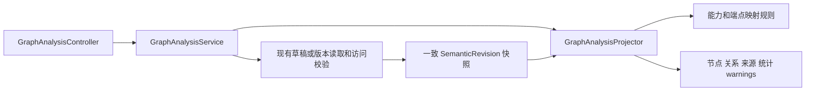

# OPD 图谱分析设计方案

日期：2026-10-30

状态：首版已实现；本文保留目标设计。实际验证、实现取舍及未达到的性能目标见实施文档第 7 节。

实施规格：[图谱分析实施文档](../../specs/opm-graph-analysis-feature-task-spec.md)

## 1. 目标与范围

在工作台“OPD 建模”“脑图分析”右侧添加“图谱分析”Tab，将已有 OPD 模型转换为二维关系网络。节点为过程、对象、状态，边表示模型中真实存在的语义关系。参考用户提供的图谱探索截图，提供统计、筛选、搜索、邻域高亮、详情和返回 OPD 定位。

首版支持当前 OPD、当前 OPD 及下级 OPD、整个模型。默认分析整个模型，包含所有层级的子图和同级图；默认读取当前后端活动草稿，支持查看明确选定的历史版本。仅切换当前 OPD 不影响全模型结果，切换模型恢复全模型范围。局部范围由用户主动选择。首版不包含跨项目聚合、三维图谱、AI 推断关系、图谱直接修改模型、中心性和最短路径分析。

图谱是模型的派生视图，不新增图数据库，不改变 OPD 布局和语义，不要求助手服务参与生成。视图中的节点拖动只影响当前分析布局。

## 2. 已核对的仓库复用点

| 现有位置 | 事实与复用方式 |
| --- | --- |
| `apps/web/src/modules/workbench/WorkbenchSurface.vue` | 已有 `OPD`、`ANALYSIS` 模式及 Tab；新增独立 `GRAPH` 模式 |
| `apps/web/src/shared/api/localRuntimeApi.ts` | 已有草稿查询、会话头和统一请求处理；扩展类型化图谱调用 |
| `services/local-runtime/src/main/java/org/opm/localruntime/application/DraftWorkspaceService.java` | 已有草稿 token、规则绑定校验和一致快照查询流程；提取或复用，避免复制校验规则 |
| `services/local-runtime/src/main/java/org/opm/localruntime/semantic/SemanticRevision.java` | 已有元素、状态、事实和出现位置，作为图谱语义来源 |
| `services/local-runtime/src/main/java/org/opm/localruntime/application/OpdProjectionQuery.java` | 已有 OPD 投影、状态呈现、端点和能力目录使用方式，可参考映射规则 |
| `apps/web/package.json` | 已有 `@antv/x6`，优先复用画布能力 |

上述复用点不代表已有图谱接口或现成力导向布局。实施前应重新核对源码与契约生成入口。

## 3. 页面与交互

```text
OPD 建模 | 脑图分析 | 图谱分析
范围选择  搜索节点  类型筛选  标签开关  刷新  适应画布
-----------------------------------------------------
统计和筛选       二维图谱画布            节点/关系详情
过程/对象/状态   缩放、拖动、邻域高亮    来源 OPD、定位
关系类型         箭头、多重边            属性、关联关系
-----------------------------------------------------
显示节点/总节点 · 显示关系/总关系 · 数据版本/更新提示
```

- 过程绿色、对象蓝色、状态紫色，同时提供类型标记和图例；不只依赖颜色。
- 状态标签使用“所属对象 · 状态名称”。名称不唯一，详情始终提供稳定 ID。
- 默认显示节点标签；边标签在悬停、选择或放大时展示，也支持全部显示。
- 点击节点突出一跳邻域，其他元素淡化；可切换两跳邻域。邻域默认按无向连接计算，箭头仍表达原始方向。
- 节点类型筛选隐藏节点及其关联边；关系筛选隐藏对应边，孤立节点保留，由“隐藏孤立节点”单独控制。
- 搜索按名称匹配并高亮，点击结果定位到图谱节点；不静默改变其他筛选项，被筛掉的结果提供恢复显示操作。
- 点击边查看关系类型、方向说明、事实 ID、端点角色和来源。多重边采用平行曲线，自环单独绘制。
- 点击“在 OPD 中定位”切换到 OPD，打开来源图并选择对应出现位置；多个来源先提供选择器。来源已删除时提示刷新，不按名称猜测目标。
- 图谱自带筛选侧栏，避免与现有 OPD 导航和助手侧栏叠加占宽；保留原侧栏状态，返回 OPD 后恢复。
- 首次进入懒加载；Tab 切换保留本工作台实例内的筛选、选择、缩放和位置。模型切换后清空，避免跨模型污染。
- 明确展示加载中、无模型元素、筛选无结果、数据过期、结果超限、加载失败等状态。

## 4. 语义投影规则

### 4.1 节点与来源

以语义实体 ID 去重，不以标签或出现位置 ID 去重。同一实体在多个 OPD 中出现，整个模型范围内仅生成一个节点，合并其 `source_refs`。不同实体即使同名也保持独立。

节点类型为 `PROCESS`、`OBJECT`、`STATE`。状态保留 `owner_id`；首版只纳入归属于对象的状态。属性/Feature 及其取值状态不伪装成对象状态，记录排除计数与原因，后续再扩展。

来源记录包含 `context_id`、`occurrence_id` 和语义目标 ID。没有可定位出现位置的语义节点可参与全模型分析，但详情中明确标记“无可定位 OPD 出现位置”。

### 4.2 关系映射

| 情况 | 规则 |
| --- | --- |
| 原始语义事实 | 保留 `fact_id`、能力 ID、端点角色、修饰信息及来源 |
| 同一事实重复出现 | 合并来源，只计一个原始关系 |
| 相同端点上的不同事实 | 保留不同边，不按端点去重 |
| 关系方向 | 根据过程/结构能力目录和端点角色确定，不根据画布坐标推断 |
| 无向、双向关系 | 使用显式方向枚举，不强行转换为单向关系 |
| 对象拥有状态 | 可选派生边 `STATE_OF`，方向约定为对象到状态，`derived=true`，不伪造事实 ID |
| 多端点关系 | 按能力语义做有依据的二元分解；保留共同 `group_id` 和完整端点 |
| 无法可靠二元表达 | 返回 warning 与排除计数；首版不增加第四类关系节点，也不做端点笛卡尔积 |
| 未识别能力 | 明确报告未支持类型，不静默丢弃、不转为因果关系 |

例如“原料 → 消耗 → 加工 → 生成 → 产品”按实际端点角色建立两条关系；不能从连通性推断“原料导致产品”。时序、影响和结构包含也必须分别解释。

返回的关系类型目录必须与当前规则绑定一致，提供名称和方向说明。用户截图中的类型仅作视觉参考，不直接作为本仓库的语义枚举。

### 4.3 范围规则

- `CONTEXT`：选中 OPD 的出现位置及其实际展示事实；默认遵循状态显隐。
- `CONTEXT_SUBTREE`：按明确的上下文父子结构遍历，再合并节点和事实；不按名称或编号推测层级。
- `MODEL`：从整个语义模型汇总实体、状态和事实，不受单张图的折叠影响。
- `include_hidden_states` 影响上下文范围；模型范围展示全部合格语义状态，界面禁用该选项并说明原因。
- 默认排除端点超出范围的关系；启用 `include_boundary_nodes` 时只补齐范围内事实直接依赖的端点，不递归扩张整个模型。
- 事实缺失端点时返回 warning，不生成悬空边。因类型限制而排除的事实与损坏数据分别统计。

统计区分别返回语义节点数、原始事实数、派生关系数、渲染边数和排除数，避免把多端点分解后的边数误当事实数。前端另算筛选后的显示数量。

## 5. 后端架构与接口



Controller 只负责请求契约和响应；Service 负责访问、版本、范围与快照；Projector 是不访问数据库的纯投影。控制层不承载关系映射规则，前端不访问持久层。

### 5.1 建议契约

以下接口首版已实现；准确字段以生成的 OpenAPI 和 JSON schema 为准。

```http
POST /api/v2/projects/{project}/models/{model}/draft/graph-analysis
POST /api/v2/projects/{project}/models/{model}/revisions/{revision}/graph-analysis
```

草稿请求字段：`request_id`、现有对象类型 `draft_token`、`context_id`、`scope`、`include_hidden_states`、`include_boundary_nodes`、`include_state_ownership`。历史请求使用路径中的 revision，不接受草稿 token；上下文范围必须提供有效 context。默认值写入 schema，未知字段处理遵循现有严格契约。

响应建议包含：

| 字段 | 内容 |
| --- | --- |
| `source` | 草稿 token 或 revision 标识、模型 ID、范围和选项、规则绑定、投影版本 |
| `nodes[]` | `id/kind/label/owner_id/source_refs/boundary` |
| `edges[]` | `id/source/target/relation_type/label/direction/fact_id/group_id/derived/source_refs` |
| `relation_types[]` | 能力 ID、显示名称、方向语义、数量 |
| `statistics` | 筛选前计数、事实数与渲染边数、排除数 |
| `warnings[]` | 原因码、相关实体/事实 ID、可展示说明 |

`direction` 使用 `DIRECTED/UNDIRECTED/BIDIRECTIONAL`。派生边的 `fact_id` 可空，ID 由来源和投影规则确定，保证刷新稳定。多端点分解 ID 还需包含端点角色和 ordinal，避免覆盖同角色重复端点。

### 5.2 一致性、安全与限制

- 复用会话、可信来源、模型访问权限和规则绑定校验；历史版本只读不代表免鉴权。
- 一个请求读取一个快照；检查完整 token，不能只比较草稿 ID。复用已有冲突错误语义，不返回混合版本。
- 未保存到正式版本但已提交后端草稿的编辑参与分析；尚未提交的输入先走 `finishInputs()`。
- 布局、筛选、邻域高亮均不修改 token、模型内容或 OPD 几何。
- 首版不需要结果落库。缓存可后置；若加入，键包含模型、完整快照身份、范围、选项、规则绑定和投影版本，且命中前仍校验权限。
- 建议完整返回上限为 2,000 节点/10,000 渲染边，作为待实测调整的初值；超限返回明确业务原因码和缩小范围建议，不静默截断、不返回误导性完整统计。最终上限在实施契约中固定。
- 排序与 ID 生成保持确定性，便于对比和布局复用。

## 6. 前端模块与生命周期

建议新增 `GraphAnalysisPanel.vue`、`GraphAnalysisCanvas.vue`、`GraphAnalysisFilters.vue`、`GraphAnalysisDetails.vue`、`useGraphAnalysis.ts`、`graphAnalysisModel.ts`、`graphAnalysisLayout.ts`。

工作台编辑模式扩展为 `OPD | ANALYSIS | GRAPH`；助手上下文继续维持现有 OPD/脑图约定，不能将 GRAPH 自动传入现有助手类型。图谱模式不自动触发脑图保存、转换或助手请求。离开脑图时仍执行既有脏数据保护。

状态包含 `loading/error/result/sourceSnapshot/scope/filters/selection/viewport/positions/stale`。工作台实例隔离，不使用跨模型共享的单例图谱状态。

加载流程：完成输入 → 捕获数据身份 → 请求 → 校验响应仍对应当前模型和快照 → 更新图数据 → 布局 → 适应画布。使用 AbortController 或请求序号拒绝迟到结果；模型或 token 变化时立即失效旧请求。重新请求失败时可保留旧图，但必须标记过期，禁止把旧来源定位到错误模型。

模型变化后默认展示“模型已更新，刷新图谱”，避免编辑时持续跳动；用户刷新后保留仍存在节点的位置，只布局新增节点。缩放与筛选不重新拉取接口。使用 ResizeObserver 适配导航、详情和底部面板变化，隐藏 Tab 暂停布局与动画，卸载销毁画布和 Worker。

## 7. 渲染与性能

优先使用现有 X6 渲染；力导向布局通过独立接口封装，X6 本身不视为已有自动布局能力。先做布局技术验证，再决定复用可用模块、实现有限布局或评审新增依赖。新增依赖必须单独明确授权和验证，不作为文档任务隐含变更。

布局计算放入 Worker；确定性初始化、限制迭代、可取消。采用全局斥力（远距离网格聚合）、统一关系弹簧、弱中心引力、标签碰撞力与速度阻尼；不按来源图强制分区，也不强制圆形拉伸。刷新与筛选保留位置；用户拖动后固定被拖节点作为本轮锚点，对其余节点重新模拟并显示中间帧。隐藏、卸载或再次拖动取消旧模拟。针对平行边、自环和密集标签做单独处理。

性能验收建议：固定记录浏览器、设备和运行模式，以 300 节点/1,000 边为主样本；接口 p95 目标不超过 1 秒、收到响应至可交互目标不超过 2 秒、筛选反馈目标不超过 200ms。上述是待基线确认的目标，并非实测成绩。另测 1,000 节点/5,000 边及超限场景，记录接口、布局、渲染分项耗时，不只统计总耗时。

## 8. 验证与后续扩展

实施验收、步骤与回滚统一见实施文档。优先验证同名异 ID、跨 OPD 去重、状态归属、关系方向、多端点分组、边界端点、快照冲突和反向定位。真实模型需逐项人工核对，不能仅依赖健康接口或截图。

后续可独立规划跨模型/项目汇总、三维布局、路径与中心性分析、导出图片和持久化分析视图。任何推断关系都必须与模型事实区分，不能混入首版原始关系计数。
