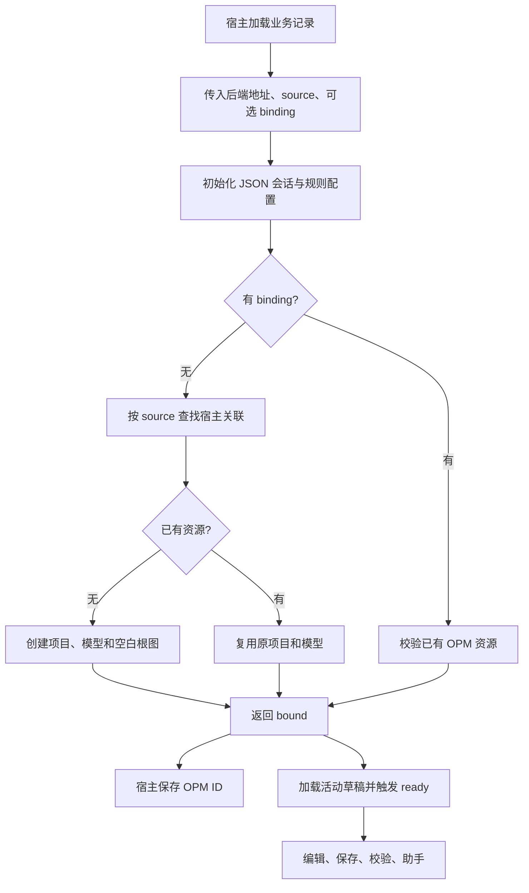

# OPM 工作台完整使用与部署指南

适用版本：`@opm/workbench 0.2.1`。更新日期：2026-10-15。

本指南对应当前仓库的实际实现，覆盖组件安装、单文件页面、参数位置、资源关联、保存和校验、后端部署、重启与数据维护。组件代码和原 OPM Studio 前端可同时使用同一套后端。

## 1. 组件与后端分别是什么

| 部分 | 职责 | 是否在组件安装包中 |
| --- | --- | --- |
| OPM 工作台 | OPD 画布、工具栏、子图导航、属性、OPL、问题、历史、方法面板及助手界面 | 是 |
| Runtime 服务 | 项目/模型存储、草稿编辑、保存、OPL 生成、校验、宿主关联与会话 | 否，单独部署 |
| 助手服务 | 对话、生成/审查编排、流式订阅、调用 Runtime | 否，按需部署 |
| 宿主系统 | 页面路由、业务项目与模型身份、显示名称、保存 OPM 关联 ID | 使用方负责 |

只读展示传入 `data` 即可，不需要后端。完整编辑使用 `backendUrl + source/binding`。助手功能还需要 `assistantUrl` 和运行中的助手服务。

0.2.0 的推荐地址模式自动初始化 JSON 会话，不需要宿主加载 `opm-bootstrap.js`、手写创建请求或安装 Pinia/Vue Router 插件。前端包不能在浏览器中运行 HTTP 代理；直接跨域连接由后端 CORS 支持，同源代理则由服务器配置。

## 2. 环境要求与版本匹配

| 环境 | 要求 |
| --- | --- |
| Vue 宿主 | Vue `^3.5.26`；组件是浏览器端组件，SSR 中仅在客户端挂载 |
| 普通 JS / React 宿主 | 支持 ESM 的构建工具，通过 JS SDK 挂载；同样需要 Vue 运行时依赖 |
| 前端构建 / 助手运行 | 本仓库验证使用 Node.js 24；建议使用 Node.js 24 |
| Runtime 构建 / 运行 | Java 17 或以上，构建时使用仓库 Maven Wrapper |
| 浏览器 | 支持 IndexedDB、ResizeObserver、现代 Fetch；示例在 Chrome 验证 |

0.2.0 地址模式需要本次更新后的 Runtime 和助手代码。**安装新 `.tgz` 不会更新正在运行的后端进程**。Runtime jar 文件名仍是 `local-runtime-0.1.0-SNAPSHOT.jar`，这个文件名不能判断是否为新代码，要以实际构建和重启为准。

## 3. 安装与构建安装包

### 3.1 在其他项目安装现有包

将 `opm-workbench-0.2.1.tgz` 放到宿主项目根目录：

```bash
npm install ./opm-workbench-0.2.1.tgz
```

使用时：

```ts
import { OpmWorkbench } from '@opm/workbench';
import '@opm/workbench/style.css';
```

Vue 已满足版本要求时无需重新安装。样式需要显式引用；画布和内部状态依赖已打包，不需要宿主配置原源码 `@/` 别名。

### 3.2 在当前仓库重新构建和打包

在仓库根目录执行：

```powershell
cd E:\00-ds-work-code\opm-diagram
npm install
npm run build:workbench --workspace=@opm/web
npm pack ./apps/web/dist-workbench --ignore-scripts
```

已安装依赖时无需每次执行 `npm install`。本仓库不跟踪 lock 文件。组件构建输出在 `apps/web/dist-workbench`；上述打包命令在当前目录生成 `.tgz`。包包含 ESM、样式、声明和包清单。以生成产物中的实际版本为准，本轮未执行 npm pack 或发布。

安装更新后的包后，重启宿主开发服务器，再刷新浏览器。组件库构建使用 `build:workbench`；仓库根 `npm run build` 还有额外契约生成检查，两者用途不同。

### 3.3 安装来源边界

本仓库不依赖上游内网 npm registry，未发布公共组件包。按第 3.2 节构建后安装自己的 `.tgz`；不要复制来源的私网地址、账号或 npm token。运行时 backendUrl/assistantUrl 填写自己部署的服务地址。

## 4. 一个文件完成接入

将以下完整代码保存到宿主的 `src/views/opm-workbench.vue`，由宿主现有路由指向该文件。所有地址、身份、名称、缓存和方法都在这一个文件中，不需要额外父页面。

先改顶部 `backendUrl`、`assistantUrl` 和 `source`。首次没有 binding 时组件自动关联；再次从缓存或宿主业务记录读取 binding。默认使用工作台自带头部和按钮，`showMethodExamples = true` 可显示演示用方法按钮。

```vue
<script setup lang="ts">
import { ref, shallowRef } from 'vue';
import {
  OpmWorkbench,
  type WorkbenchBinding,
  type WorkbenchHandle,
  type WorkbenchSource,
} from '@opm/workbench';
import '@opm/workbench/style.css';

// 所有配置都在本文件；也可以从当前页面 URL 读取业务信息。
const params = new URLSearchParams(window.location.search);
const backendUrl = params.get('backendUrl') ?? 'http://127.0.0.1:17850';
const assistantUrl = params.get('assistantUrl') ?? 'http://127.0.0.1:17860';

// 本机模式可省略；远程模式使用宿主登录流程取得的接入凭证。
// 可替换为异步获取凭证的函数，不要使用 AI 服务密钥。
const accessToken: string | undefined = undefined;

// 这里是宿主业务 ID，不是 OPM 后端生成的 ID。
const source: WorkbenchSource = {
  systemId: params.get('systemId') ?? 'my-system',
  projectId: params.get('businessProjectId') ?? 'demo-project',
  projectName: params.get('projectName') ?? '我的业务项目',
  modelId: params.get('businessModelId') ?? 'demo-model',
  modelName: params.get('modelName') ?? '我的 OPM 模型',
};

const binding = shallowRef<WorkbenchBinding>();
const workbench = ref<WorkbenchHandle | null>(null);
const ready = ref(false);
// 默认使用组件自带工具栏；改为 true 可查看宿主调用方法的演示按钮。
const showMethodExamples = false;
const methodNotice = ref('');
const configurationError = ref('');
const cacheNotice = ref('');

// 每个后端、系统、业务项目和模型分别保存关联。
const storageKey = 'opm-workbench:v2:' + JSON.stringify([
  backendUrl.trim().replace(/\/+$/, ''),
  source.systemId,
  source.projectId,
  source.modelId,
]);

function validBinding(value: unknown): value is WorkbenchBinding {
  if (!value || typeof value !== 'object') return false;
  const item = value as Partial<WorkbenchBinding>;
  const pattern = /^[A-Za-z][A-Za-z0-9._:-]{2,127}$/;
  return typeof item.projectId === 'string' && pattern.test(item.projectId)
    && typeof item.modelId === 'string' && pattern.test(item.modelId);
}

// URL 的 projectId/modelId 专门用于打开已有 OPM 模型。
const opmProjectId = params.get('projectId')?.trim() || '';
const opmModelId = params.get('modelId')?.trim() || '';

if (opmProjectId || opmModelId) {
  const candidate = { projectId: opmProjectId, modelId: opmModelId };
  if (!validBinding(candidate)) {
    configurationError.value = '请同时提供有效的 OPM projectId 和 modelId。';
  } else {
    binding.value = candidate;
  }
} else {
  try {
    const raw = localStorage.getItem(storageKey);
    if (raw) {
      const cached: unknown = JSON.parse(raw);
      if (!validBinding(cached)) throw new Error('缓存格式无效');
      binding.value = cached;
    }
  } catch {
    cacheNotice.value = '缓存无法读取，工作台将通过后端确认资源关联。';
  }
}

// 首次自动创建/查找后，组件将 OPM ID 返回到此方法。
function saveBinding(value: WorkbenchBinding) {
  console.log('OPM projectId:', value.projectId);
  console.log('OPM modelId:', value.modelId);
  binding.value = { ...value };
  try {
    localStorage.setItem(storageKey, JSON.stringify(value));
    cacheNotice.value = '';
  } catch {
    cacheNotice.value = '当前浏览器无法保存关联缓存，重新进入时后端仍可根据业务 ID 查找。';
  }
  // 正式环境可在这里调用宿主接口，把 value 保存到业务记录。
}

async function save() {
  if (!ready.value || !workbench.value) return;
  await workbench.value.save();
  methodNotice.value = '保存调用已结束，请以工作台保存状态为准。';
}

async function validate() {
  if (!ready.value || !workbench.value) return;
  await workbench.value.validate();
  methodNotice.value = '校验调用已结束，请查看工作台问题面板。';
}

function reload() {
  ready.value = false;
  workbench.value?.reload?.();
}

function resize() { workbench.value?.resize(); }

async function prepareLeave() {
  if (!workbench.value) return false;
  const allowed = await workbench.value.prepareLeave();
  methodNotice.value = allowed ? '允许离开，可以继续宿主的导航操作。' : '已取消离开。';
  // 只有 allowed 为 true 时才执行宿主路由跳转或切换业务记录。
  return allowed;
}
</script>

<template>
  <main class="opm-page">
    <p v-if="configurationError" class="error" role="alert">{{ configurationError }}</p>
    <p v-if="cacheNotice" class="notice" role="status">{{ cacheNotice }}</p>
    <div v-if="showMethodExamples" class="method-examples">
      <button :disabled="!ready" @click="save">调用保存</button>
      <button :disabled="!ready" @click="validate">调用校验</button>
      <button @click="reload">重新连接</button>
      <button :disabled="!ready" @click="resize">适配画布</button>
      <button :disabled="!ready" @click="prepareLeave">检查是否允许离开</button>
      <span>{{ methodNotice }}</span>
    </div>

    <div v-if="!configurationError" class="workbench-container">
      <OpmWorkbench
        ref="workbench"
        :backend-url="backendUrl"
        :assistant-url="assistantUrl"
        :access-token="accessToken"
        :source="source"
        :binding="binding"
        :show-header="true"
        :project-navigation="false"
        :show-profile="false"
        :show-version-controls="false"
        @bound="saveBinding"
        @ready="ready = true"
      />
    </div>
  </main>
</template>

<style scoped>
.opm-page { min-height: 500px; }
.workbench-container { height: calc(100vh - 80px); min-height: 500px; }
.error { color: #b42318; }
.notice { color: #65758a; margin: 8px 0; }
.method-examples { display: flex; gap: 8px; align-items: center; flex-wrap: wrap; }
</style>
```

示例里的 `demo-project/demo-model` 只用于演示。正式业务必须使用宿主当前项目/建模记录的稳定 ID；每条建模记录要有独立 `modelId`。不要在每次页面刷新时生成新的 UUID，也不要让所有业务模型都使用同一个默认 ID。

默认示例使用浏览器缓存，完整逻辑不依赖缓存一定存在。后端也记录 source 关联，缓存丢失后传入相同 source 可恢复原资源。生产应在 `saveBinding()` 中保存到宿主业务数据库，读取后赋给 binding，以支持跨浏览器、跨用户使用。宿主的实际字段可采用：

```json
{
  "opmEnvironment": "production",
  "opmProjectId": "project.后端生成的ID",
  "opmModelId": "model.后端生成的ID"
}
```

`opmEnvironment` 是宿主的环境标识，不是组件参数；它防止开发和生产的 binding 混用。示例 URL 参数仅在页面初始化时读取；SPA 中切换业务记录应使用响应式 source/binding，先调用 `prepareLeave()`，再原子更新两个值，不能保留旧 binding 打开新 source。

地址模式不再需要原 `index.html` 的 bootstrap 脚本。移除宿主旧例子中的 `createLocalRuntimeServices()`、手写 `post()`、项目模型创建函数和全局会话检查。原 OPM Studio 的 bootstrap 和代理属于原宿主，不需要删除。

## 5. 参数在什么位置填写

Vue 模板用 kebab-case，例如 `:backend-url="backendUrl"`；JS SDK 配置对象用 camelCase，例如 `{ backendUrl }`。字符串常量可直接写 `backend-url="http://..."`，对象和布尔变量使用 `:` 绑定。

### 5.1 对外参数表

| 参数 | 类型 | 默认 / 使用位置 |
| --- | --- | --- |
| `backendUrl` | string | 地址模式必填；Runtime 服务根地址，不是某个 API 地址 |
| `assistantUrl` | string | 可选；助手服务根地址；不提供则关闭助手 |
| `accessToken` | string 或 `() => string/Promise<string>` | 远程模式需要；本机默认可省略；用于 JSON 会话初始化 |
| `source` | WorkbenchSource | 首次关联的宿主项目/模型信息；名称用于展示 |
| `binding` | WorkbenchBinding | 已保存的 OPM ID；首次可为空；优先于 source 进入资源解析 |
| `context` | WorkbenchContext | 可选；指定当前 OPD/版本，或为只传 binding 的页面提供显示名称 |
| `data` | WorkbenchSnapshot | 提供后进入只读快照模式，优先于后端/服务接入 |
| `services` | WorkbenchServices | 高级或旧接入方式；宿主自行注入 Runtime/助手服务 |
| `showHeader` | boolean | 默认 false；显示工作台头部、名称、保存状态和校验入口 |
| `projectNavigation` | boolean | 默认 false；项目名为文本；true 时项目按钮发送导航事件 |
| `showProfile` | boolean | 默认 false；规则/Profile 版本标签 |
| `showVersionControls` | boolean | 默认 false；草稿版本身份与版本选择器 |

完整编辑不要同时传 `data`，否则只读。地址模式使用自动生成的 services，无需同时传入 services。0.2.0 的默认空白工作台没有服务，不能以它代替已关联资源的完整编辑。

### 5.2 source：填写宿主自己的身份

```ts
const source = {
  systemId: 'asset-management',
  projectId: '宿主项目UUID',
  projectName: '智能仓储项目',
  modelId: '宿主建模记录UUID',
  modelName: '船舶模型',
};
```

| 字段 | 含义 |
| --- | --- |
| `systemId` | 宿主系统标识；可省略，默认 default；同系统保持一致，不是登录用户 ID |
| `projectId` | 宿主业务项目 ID；不是 OPM 项目 ID |
| `projectName` | 外部传入的项目显示名称，也是首次创建时的初始名称 |
| `modelId` | 宿主建模记录 ID；同一业务项目下多个模型分别使用不同 ID |
| `modelName` | 外部传入的模型显示名称，也是首次创建时的初始名称 |

宿主 ID 可以数字开头，允许 UUID；这些字段是非空字符串，最长 512 字符。关联按 `systemId + projectId` 和追加 `modelId` 区分，**名称不参与主键**。改名不新建资源、不自动重命名后端模型，显示名称以宿主为准。同项目不同模型同名时，后端内部名称可能追加身份后缀以符合原名称唯一约束。

### 5.3 binding：填写后端返回的身份

```ts
binding.value = {
  projectId: 'project.21e3678e7d4141d8b84ddd135d6a118d',
  modelId: 'model.f389794b93a245879ac9dc7b3facd7c0',
};
```

这里只能使用目标 OPM 后端实际返回/已有的 ID，不能把业务 UUID 添加 `project.` 前缀当成真实资源。API 校验 ID 以字母开头、长度 3～128，后续允许字母、数字、`._:-`。

binding 已指定但资源不存在、归档或格式错误时，组件报错，**不会自动创建替代资源**。不要靠清空 binding 或改业务 ID 掩盖数据路径配置错误；先确认后端与存储目录正确。0.1.x 中已有模型仍可通过 binding 打开；它不会自动建立该模型到新 source 的反向关联，后续应继续保存并传回这个 binding。

### 5.4 context：OPD 和历史版本定位

```ts
const context = {
  activeContextId: 'context.root.真实ID',
  revision: 'revision.真实历史版本ID',
};
```

默认不传 revision，打开活动草稿；指定固定版本通常为只读。当前 OPD 不指定时由后端打开根图。只传 binding 时可以在 context.project.name/context.model.name 提供显示名称；source 名称的优先级更高。

## 6. 返回事件与调用时机

| Vue 模板事件 | JS SDK 名称 | 参数 | 用途 |
| --- | --- | --- | --- |
| `@bound` | bound | `{ projectId, modelId }` | 自动关联解析成功，打印并保存 OPM ID |
| `@ready` | ready | 无 | 工作台指定位置加载完成；可启用宿主操作按钮 |
| `@error` | error | string | 连接/加载等错误提示；不是所有业务操作结果的统一回调 |
| `@context-change` | contextChange | string | 当前 OPD 身份改变 |
| `@revision-change` | revisionChange | string/undefined | 当前版本状态改变 |
| `@selection-change` | selectionChange | string[] | 选中元素身份改变 |
| `@navigate-project` | navigateProject | string | 需要项目导航时交给宿主处理 |

bound 是“关联已解析”，不是“整个画布已经加载完成”。它可能在首次解析、再次打开或重连时出现，宿主保存应使用更新/覆盖同一业务记录的方式，而不是每次新建一条关联。ready 也不是保存成功事件。

```ts
function saveBinding(value: WorkbenchBinding) {
  console.log('OPM projectId:', value.projectId);
  console.log('OPM modelId:', value.modelId);
  binding.value = { ...value };
  // 保存到宿主数据库或缓存。
}
```

## 7. 保存、校验、重连与离开

Vue 用 `ref="workbench"` 获取实例，脚本声明 `ref<WorkbenchHandle | null>(null)`。组件挂载且 ready 后再调用方法。

| 方法 | 返回类型 | 实际作用与边界 |
| --- | --- | --- |
| `save()` | Promise<void> | 完成当前输入并请求保存；包含本地布局提交；只读/未就绪时不执行写入 |
| `validate()` | Promise<void> | 请求当前模型基础校验，在问题面板展示结果 |
| `reload()` | void | 重新连接、重新取得会话并加载；调用前处理未保存布局 |
| `resize()` | void | 重新适配画布视图，可能调整缩放；一般容器变化由 ResizeObserver 处理 |
| `prepareLeave()` | Promise<boolean> | 检查分析和未保存布局，可能弹出保存/放弃提示；true 才继续导航 |

`save()` 和 `validate()` 不返回业务成功布尔值，也不保证失败都以 Promise reject 抛出。调用结束后观察组件保存状态、错误反馈或问题面板；不要直接把 `await save()` 当作“保存成功”。当前没有公开 `save-success` 事件，也没有 `getData()` 方法，不要调用未实现接口。

示例同文件中已有方法，基本调用是：

```ts
await workbench.value?.save();
await workbench.value?.validate();
workbench.value?.reload?.();
workbench.value?.resize();

// 业务项目/模型切换或路由离开之前：
const allowed = await workbench.value?.prepareLeave();
if (allowed) {
  // 执行当前宿主已有的路由跳转，或同时更新 source/binding。
}
```

未保存布局检查应在**卸载前**进行；不能等 Vue 已卸载再调用。修改 backendUrl、services 或业务身份可能重新创建实例，先 prepareLeave，用户取消就不要切换。手动保存不等于再次创建项目/模型；bound 保存的是关联，save 保存的是模型内容。

### 7.1 页面上如何保存

默认使用画布工具栏左侧保存按钮，嵌入画布聚焦后可用 Ctrl/Cmd+S。运行校验使用工作台头部按钮。语义操作会提交草稿；手动拖动/对齐形成的布局需要保存，不能仅凭“草稿已保护”判断布局保存。失败时按反馈处理或恢复待确认请求。

当前校验是已实现规则的校验，不等于 ISO 19450 全面符合性证明。问题、OPL、历史和架构方法面板用于核对结果。

### 7.2 复制永久链接

原 OPM Studio 会固定当前版本并复制带 revision/context 的只读链接。未保存布局需先手动保存。外部嵌入默认没有该按钮，因为它依赖原宿主路由恢复定位；showHeader/showVersionControls 不会启用它。目前没有公开的嵌入 permalink 参数。

### 7.3 草稿状态同步与部署更新

当前源码已将周期查询改为 GET `/api/v2/projects/{projectId}/models/{modelId}/draft/save-state`。空闲时每 15 秒查询；存在待自动检查点内容、正在保存或待确认操作时每 2 秒查询。页面隐藏、工作台被 KeepAlive 停用时暂停，恢复后立即同步。每次请求结束后再计时，不积累并发请求；失败逐步退避，最长 30 秒。外部页面修改同一草稿仍会触发冲突提示并转为只读，可处理当前输入后调用 reload 重新打开。

`draft/open` 不再用于定时状态轮询，首次加载、重载和语义编辑回读仍可能调用它。状态查询只读取元数据，不重建模型 JSON 或重放日志；实际打开、编辑和保存继续完整校验。后端自动保存协调器也使用元数据每秒检查期限，原 10 秒期限不重置，正常调度下检查点可能最多晚约 1 秒开始。查询本身不创建模型、历史版本或检查点，也不会提交本地未保存布局。浏览器使用 `cache: no-store`，后端返回 `Cache-Control: no-store`。

宿主使用 backendUrl/assistantUrl 或默认 Runtime services 时不需添加参数。自定义 `WorkbenchRuntimeApi` 适配器需实现 `draftSaveState(projectId, modelId): Promise<SaveState>`，使用既有实例地址和会话认证，返回接口原始状态对象。更新组件需从当前源码构建；后端优化需重新构建部署 Runtime 并重启生效。旧库先按 SQLite 转换说明验证，不能直接用新 Flyway 基线打开旧库。

## 8. 首次与再次进入的完整逻辑



项目关联键是 systemId+宿主项目ID，模型再追加宿主模型ID。同一项目新增第二个模型复用 OPM 项目。重复请求、响应丢失、刷新和服务重启不会因为请求 ID 变化而重复创建。

后端项目/模型删除、归档后会报错；模型永久删除后关联墓碑防止同 source 悄悄重建。宿主如果确实要创建新的建模记录，应分配新的业务模型身份，再按新 source 进入。

新增**同一模型内的子图**用导航“＋”及对象/过程细化；它不是新模型，不需要更换宿主 modelId。

## 9. 后端构建与需要部署的文件

### 9.1 Runtime 构建

Java 17 或以上环境下，在仓库根目录：

```powershell
$env:JAVA_HOME = 'D:\jdk-17'
./mvnw.cmd -pl services/local-runtime -am package -DskipTests
```

Linux/macOS 对应 `./mvnw`；也可使用系统 Maven：`mvn -pl services/local-runtime -am package -DskipTests`。企业镜像需要使用自己的 Maven settings。

构建后部署：

| 文件/目录 | 要求 |
| --- | --- |
| `services/local-runtime/target/local-runtime-0.1.0-SNAPSHOT.jar` | 运行代码与 classpath migration 已打包 |
| `packages/profiles` | 保持目录结构和原字节；Runtime 通过 assets.root 加载 |
| Runtime 数据根目录 | SQLite catalog.db、项目 project.db、草稿与修订；必须备份 |

仅替换 jar，不清空存储目录。Profile 资产需要与构建版本匹配，不能随意修改换行或摘要。

### 9.2 助手部署

助手是 Node 服务，部署更新后的 `apps/assistant`、它引用的仓库资源和生产依赖；建议第一期保留完整仓库工作目录，通过 workspace 运行，避免漏掉模型工具和规则资源。

```bash
npm install
npm run assistant:dev
```

生产通过进程管理器托管，明确工作目录和数据路径。助手还需要可达的 AI 提供商、服务端密钥和模型配置；没有助手时不传 assistantUrl，Runtime 完整编辑仍可用。

## 10. 本机开发部署（不用前端代理）

### 10.1 启动 Runtime

PowerShell，在仓库根目录执行；使用自己的绝对数据路径。下例使用全新 SQLite 目录，旧数据先按转换说明迁移：

```powershell
cd E:\00-ds-work-code\opm-diagram
$env:OPM_REMOTE_ENABLED = 'false'
$env:OPM_RUNTIME_HOST = '127.0.0.1'
$env:OPM_TRUSTED_WEB_ORIGINS = 'http://localhost:3000,http://127.0.0.1:3000,http://localhost:5173,http://127.0.0.1:5173'

& 'D:\jdk-17\bin\java.exe' -jar `
  'services/local-runtime/target/local-runtime-0.1.0-SNAPSHOT.jar' `
  '--server.port=17850' `
  '--opm.storage.root=E:\00-ds-work-code\opm-diagram\runtime-data-new' `
  '--opm.assets.root=E:\00-ds-work-code\opm-diagram\packages\profiles'
```

OPM_REMOTE_ENABLED=false 不需要 accessToken；本机仍要有有效 Origin，会话仍会初始化。前端用 `http://127.0.0.1:3000` 最直观；localhost 与 127.0.0.1 混用时将两个精确来源都列入配置。

### 10.2 启动助手

另开一个终端：

```powershell
cd E:\00-ds-work-code\opm-diagram
$env:OPM_REMOTE_ENABLED = 'false'
$env:OPM_ASSISTANT_HOST = '127.0.0.1'
$env:OPM_ASSISTANT_PORT = '17860'
$env:OPM_RUNTIME_ORIGIN = 'http://127.0.0.1:17850'
$env:OPM_TRUSTED_WEB_ORIGINS = 'http://localhost:3000,http://127.0.0.1:3000,http://localhost:5173,http://127.0.0.1:5173'
$env:OPM_ASSISTANT_DATA = 'E:\00-ds-work-code\opm-diagram\runtime-data\assistant'
npm run assistant:dev
```

AI 配置放助手 `.env.local` 或启动环境，示例变量见第 11 节。已有 .env.local 不要覆盖。若从远程模式切回本机模式，确认助手环境没有残留错误的 OPM_RUNTIME_ACCESS_TOKEN/OPM_EMBEDDED_ACCESS_TOKEN；助手检测到该值时会使用凭证会话初始化路径。

## 11. 局域网 IP 和服务器部署

### 11.1 Runtime/助手配置表

| 配置 | 服务 | 用途 |
| --- | --- | --- |
| `OPM_RUNTIME_HOST` | Runtime | 默认 127.0.0.1；直接暴露 IP 时设 0.0.0.0；内网代理后可保留回环 |
| `--server.port` | Runtime 启动参数 | 默认 17850 |
| `--opm.storage.root` | Runtime 启动参数 | 必须使用固定绝对持久化目录 |
| `--opm.assets.root` | Runtime 启动参数 | 固定绝对 Profile 目录 |
| `OPM_REMOTE_ENABLED` | 两个服务 | true 开启远程 Host/Origin 接入；Runtime 必须同时配置凭证 |
| `OPM_TRUSTED_WEB_ORIGINS` | 两个服务 | **浏览器宿主页面来源**，精确协议+主机+端口，多个逗号分隔，不带路径或通配符 |
| `OPM_EMBEDDED_ACCESS_TOKEN` | Runtime | JSON session 的部署接入凭证；运行远程模式必须设置 |
| `OPM_ASSISTANT_HOST` / `OPM_ASSISTANT_PORT` | 助手 | 默认 127.0.0.1:17860；直连 IP 可设 0.0.0.0 |
| `OPM_RUNTIME_ORIGIN` | 助手 | 从助手服务器可达的 Runtime 根地址，不是宿主页面地址 |
| `OPM_RUNTIME_ACCESS_TOKEN` | 助手 | 与目标 Runtime 的接入凭证相同；未设时可使用 OPM_EMBEDDED_ACCESS_TOKEN |
| `OPM_ASSISTANT_DATA` | 助手 | 固定绝对持久化目录，保存对话和方案 |
| `DEEPSEEK_API_KEY` | 助手 | AI 服务端密钥；openai provider 时仍使用此变量名 |
| `DEEPSEEK_BASE_URL` / `DEEPSEEK_MODEL` | 助手 | AI 提供商地址和模型；不是 OPM Runtime 地址 |
| `OPM_MODEL_PROVIDER` | 助手 | deepseek 或 openai；openai 使用兼容 Chat Completions |
| `OPM_MODEL_HTTP_ORIGIN` | 助手 | 私网 HTTP AI 网关使用时精确配置来源；优先 HTTPS |

### 11.2 局域网示例

假设 Runtime/助手在 `192.168.1.10`，宿主页面在 `http://192.168.1.20:3000`：

```powershell
# Runtime 启动终端
$env:OPM_RUNTIME_HOST = '0.0.0.0'
$env:OPM_REMOTE_ENABLED = 'true'
$env:OPM_TRUSTED_WEB_ORIGINS = 'http://192.168.1.20:3000'
$env:OPM_EMBEDDED_ACCESS_TOKEN = '<部署接入凭证>'
# 用第 10 节的 jar 命令启动，保留实际的绝对存储/资产路径。
```

```powershell
# 助手启动终端；同一服务器上的 Runtime 可通过回环连接。
$env:OPM_ASSISTANT_HOST = '0.0.0.0'
$env:OPM_ASSISTANT_PORT = '17860'
$env:OPM_REMOTE_ENABLED = 'true'
$env:OPM_TRUSTED_WEB_ORIGINS = 'http://192.168.1.20:3000'
$env:OPM_RUNTIME_ORIGIN = 'http://127.0.0.1:17850'
$env:OPM_RUNTIME_ACCESS_TOKEN = '<相同的部署接入凭证>'
$env:OPM_ASSISTANT_DATA = '<绝对助手数据目录>'
$env:DEEPSEEK_API_KEY = '<AI 服务端密钥>'
$env:DEEPSEEK_BASE_URL = 'https://api.deepseek.com'
$env:DEEPSEEK_MODEL = 'deepseek-flash'
$env:OPM_MODEL_PROVIDER = 'deepseek'
npm run assistant:dev
```

组件改为：

```ts
const backendUrl = 'http://192.168.1.10:17850';
const assistantUrl = 'http://192.168.1.10:17860';
const accessToken = '<部署接入凭证>'; // 局域网接入演示
```

生产通过宿主认证流程提供 accessToken 函数，不把 AI 密钥传入前端。当前接入凭证是共享 Runtime 的访问模型，具有共享服务权限，不等于每个用户只能访问自己的模型；多租户/用户角色授权尚未实现。

跨机器时确保两个端口可达。`127.0.0.1` 在浏览器请求中指用户自己的电脑，不是服务器。**OPM_RUNTIME_ORIGIN 则从助手服务所在机器解析**，两个地址的观察位置不同。

### 11.3 Linux 服务器启动示例

假设完整仓库/部署资源在 `/opt/opm`，持久数据在 `/var/lib/opm`。首次部署创建空目录；已有数据使用既有目录，不以空目录替代。

```bash
cd /opt/opm
export OPM_REMOTE_ENABLED=true
export OPM_TRUSTED_WEB_ORIGINS=https://host.example.com
export OPM_EMBEDDED_ACCESS_TOKEN='<部署接入凭证>'
export OPM_RUNTIME_HOST=127.0.0.1

/usr/bin/java -jar services/local-runtime/target/local-runtime-0.1.0-SNAPSHOT.jar \
  --server.port=17850 \
  --opm.storage.root=/var/lib/opm/runtime \
  --opm.assets.root=/opt/opm/packages/profiles
```

助手启动环境同第 11.2 节，路径换为 `/var/lib/opm/assistant`，服务监听 127.0.0.1。进程管理器设置 WorkingDirectory=/opt/opm，保留这些绝对路径与环境变量。发布时替换 jar/助手代码后重启，**不删除 /var/lib/opm**。

前端可以直连分别启用 HTTPS 的两个域名，也可以通过下面的同源代理路径。HTTPS 宿主不能 fetch HTTP 后端，否则浏览器会阻止混合内容。

### 11.4 Nginx 同源路径配置

以下 location 放进宿主 `https://host.example.com` 的现有 server 块。TLS 证书和宿主静态文件配置使用现有部署配置：

```nginx
location /opm/ {
    # 末尾斜杠：将 /opm/api/... 转发为后端 /api/...
    proxy_pass http://127.0.0.1:17850/;
    proxy_set_header Host $proxy_host;
    proxy_set_header Origin $http_origin;
    proxy_set_header Referer $http_referer;
    proxy_set_header X-OPM-Session $http_x_opm_session;
    proxy_set_header Authorization $http_authorization;
    proxy_read_timeout 180s;
}

location = /opm/opm-bootstrap.js {
    # 地址模式使用 JSON session，不公开原本机 bootstrap。
    return 404;
}

location /opm-assistant/ {
    proxy_pass http://127.0.0.1:17860/;
    proxy_set_header Host $proxy_host;
    proxy_set_header Origin $http_origin;
    proxy_set_header X-OPM-Session $http_x_opm_session;
    proxy_set_header Authorization $http_authorization;
    proxy_http_version 1.1;
    proxy_set_header Connection "";
    proxy_buffering off;
    proxy_cache off;
    proxy_read_timeout 900s;
}
```

组件填写：

```ts
const backendUrl = '/opm';
const assistantUrl = '/opm-assistant';
```

后端仍设置 remoteEnabled=true、接入凭证，以及 `https://host.example.com` 来源。代理不伪造任意 Origin，也不替组件自动获得授权。助手关闭缓冲是为了 SSE 能及时到达浏览器。

backendUrl/assistantUrl 都是根路径，不填写 `/api/v1` 或 `/api/assistant`，客户端会自行追加接口路径。反向代理和证书是服务器职责，浏览器组件不会自行安装 Nginx 或修改后端 allowlist。

## 12. 数据目录、升级与重启

### 12.1 必须固定绝对路径

默认 `opm.storage.root=runtime-data` 是相对于 Runtime 工作目录的路径。Maven 在模块目录启动和 jar 在仓库根启动会指向不同位置，页面可能从多个项目突然变成一个项目，**不等于数据被删除**。

本仓库已经核实的原业务目录是：

```text
E:\00-ds-work-code\opm-diagram\services\local-runtime\runtime-data
```

后续启动始终显式带：

```text
--opm.storage.root=E:\00-ds-work-code\opm-diagram\services\local-runtime\runtime-data
```

Runtime 资产也使用绝对路径，助手通过 OPM_ASSISTANT_DATA 固定目录。不要仅因为仓库根也有 runtime-data 就认定它是原数据目录。

### 12.2 数据各保存在哪里

| 数据 | 位置 | 浏览器清缓存的影响 |
| --- | --- | --- |
| 项目、模型、关系、草稿、修订与宿主关联 | SQLite 根目录下 projects/<projectId>/project.db | 后端数据不被清除 |
| 助手对话与方案 | OPM_ASSISTANT_DATA | 后端数据不被清除 |
| 示例的 OPM binding | 宿主 localStorage，建议生产改宿主数据库 | 丢失缓存；同 source 可从后端恢复 |
| 未确认编辑/保存请求 | 浏览器 IndexedDB，按 Runtime 地址区分 | 清除可能丢失尚未确认的恢复记录 |
| 会话令牌 | 组件客户端实例内存 | 刷新/重连重新取得 |

Runtime 仅使用 SQLite，项目写入受事务与并发控制保护。备份使用桌面一致备份，或停服后备份整个数据根及独立资产；运行中不可只复制 `.db` 而遗漏 WAL。旧库兼容边界见 [SQLite 转换说明](sqlite-storage-upgrade.md)。宿主 binding 应按后端环境保存，换一台空后端不能拿旧 ID 自动恢复模型内容。

### 12.3 重启顺序

1. 记录当前 Runtime 绝对数据目录、资产目录、助手目录和来源配置。
2. 保存正在编辑的布局，停止需要替换的服务，不停止无关宿主项目。
3. 替换构建产物，按相同绝对目录启动 Runtime，确认健康检查。
4. 启动助手，确认助手连接同一份 Runtime 和相同接入凭证。
5. 刷新页面或调用 reload，取得新会话。
6. 检查项目数量、原模型 ID、草稿和新建的模型都在预期目录。

本机组件使用 localhost:3000 和 127.0.0.1:3000 两个来源时，两种预检都应通过。只重启前端不能让旧 Java/Node 进程加载后端修改。

## 13. 部署后的请求逻辑与接口

| 时机 | Runtime/助手接口 | 处理逻辑 |
| --- | --- | --- |
| 组件首次连接或 reload | POST `/api/v1/integration/session` | 校验来源和远程凭证，返回实例会话/规则 |
| 有 source 没有 binding | POST `/api/v1/integration/workspace` | 查关联；没有时创建项目/模型/根图，返回 OPM ID |
| 有 binding | 同 workspace 接口 | 只校验并打开已有资源，binding 优先 |
| 打开工作台 | v1/v2 模型、草稿、投影等接口 | 加载当前状态；绑定成功后触发 ready |
| 语义编辑 | v2 draft commands | 能力选项授权、草稿提交、回读 |
| 手动保存 | v2 draft save 等 | 提交未保存布局、保存并更新状态 |
| 智能助手 | `/api/assistant/...` | 使用同 Runtime 会话，生成/审查/确认后修改 |
| 助手订阅 | POST `/api/assistant/watch` | SSE；组件卸载终止订阅，后台任务由服务管理 |

宿主通常不直接调用这些请求，组件会封装。原后端错误协议保留；API 精确定义见 [嵌入接口契约](../contracts/opm-embedded-workspace.md)。

部署后返回的 binding 仍需要宿主保存，不能把它当作自动写进宿主数据库的动作。OPM 关联与宿主业务记录之间的持久化是 saveBinding 所在位置的职责。

## 14. 普通 JS / React 与高级接入

Vue 推荐第 4 节单文件页面。其他系统可以直接用 SDK：

```ts
import { init } from '@opm/workbench';
import '@opm/workbench/style.css';

const container = document.getElementById('opm-container');
if (!container) throw new Error('工作台容器不存在');

const workbench = init(container, {
  backendUrl: 'http://127.0.0.1:17850',
  assistantUrl: 'http://127.0.0.1:17860',
  source: {
    systemId: 'my-system', projectId: '业务项目ID', projectName: '项目名称',
    modelId: '业务模型ID', modelName: '模型名称',
  },
  showHeader: true,
});

workbench.on('bound', value => {
  console.log(value.projectId, value.modelId);
  // 在宿主保存关联。
});
workbench.on('ready', () => console.log('工作台已加载'));
workbench.on('error', message => console.error(message));

// 仅在已经加载时按业务需要调用：
// await workbench.save();
// await workbench.validate();
// workbench.reload();
// workbench.resize();

// 页面卸载前先检查 prepareLeave；确认可离开后：
// workbench.dispose();
```

容器设置明确高度；React 在 effect 挂载、cleanup dispose，Vue 组件本身卸载会清理资源。`on/off` 支持监听管理。`setOption()` 更新配置或上下文；`setData()` 整体替换只读快照，不能拿它注入编辑后的语义结果，编辑结果由服务协议回读。

`createOpmClient({ backendUrl, assistantUrl, accessToken })` 暴露 connect、ensureWorkspace、services，可用于需要自行控制初始化时机的宿主。旧 services 模式继续使用 `createRuntimeServices(apiAdapter, assistantAdapter)`；原应用使用 createLocalRuntimeServices 和原 bootstrap，外部页面不必采用旧模式。

只读快照模式示例：

```vue
<OpmWorkbench
  :context="{ project: { name: '外部项目' }, model: { name: '模型名称' } }"
  :data="{ diagrams: [{ id: 'root', label: 'SD', kind: 'SYSTEM_DIAGRAM', depth: 0, nodes: [], relations: [] }] }"
  show-header
/>
```

快照包含每个 OPD 的节点、关系和可选 OPL 等数据；不是 X6 内部 JSON。节点的语义 id 和图中 occurrenceId 应保持正确。

## 15. 常见错误与排查

| 现象 | 常见原因 | 处理 |
| --- | --- | --- |
| preflight 无 Access-Control-Allow-Origin | 仍运行旧后端、来源未允许、代理路由错误 | 更新并重启后端，检查 OPTIONS 响应与精确来源 |
| 本地会话、Host 或 Origin 无效 | localhost/127.0.0.1 混用、会话过期、远程凭证缺失 | 配置实际来源，更新凭证，刷新/reload |
| integration/session 404 | 后端没有 0.2.0 接入代码，或 base URL 前缀错误 | 更新 Runtime，确认地址不重复包含 API 路径 |
| 草稿请求格式无效 | 将宿主 UUID 作为 OPM ID、空 context_id、协议不匹配 | 宿主 ID 放 source，OPM ID 放 binding，核对实际失败请求 |
| 空白/按钮灰色 | data 只读模式、未 ready、历史版本、关联/服务加载失败 | 查看 mode 参数、加载状态与错误反馈 |
| 刷新后新建了另一个模型 | systemId/业务 ID 改变、换后端、换存储根 | 使用稳定 source 和正确环境/存储目录 |
| 重启后项目突然只剩一条 | 相对 runtime-data 指向不同工作目录 | 核对旧目录，改用显式绝对 storage.root；不要删除旧数据 |
| 模型不存在/归档 | binding 属于另一环境、资源归档/删除 | 核对后端和关联；不要自动清空 binding 新建替代 |
| 智能助手不显示 | assistantUrl 未传 | 提供运行中的助手服务根地址 |
| 助手请求/SSE 失败 | 旧助手、会话校验失败、错误 Runtime、代理缓冲 | 更新助手，核对相同 Runtime/凭证，关闭 SSE 缓冲 |
| 复制永久链接不显示 | 当前是外部嵌入 | 现版本只原宿主提供，非配置遗漏 |
| 保存调用结束但仍“布局未保存” | 候选未完成、保存失败或未确认 | 依据工作台反馈处理，不凭 Promise 完成判断成功 |

不要用 Fetch `mode: 'no-cors'` 绕过 CORS；opaque 响应无法被组件读取。也不要通过禁用后端校验解决错误，先看请求地址、Origin、状态码和接口响应。诊断时不打印会话令牌或密钥。

## 16. 可执行验收与检查

### 16.1 上线前检查

1. Runtime/助手是最新构建，两个服务健康检查 HTTP 200。
2. 数据/资产/助手目录为固定绝对路径，已有模型数量与 ID 正确。
3. 浏览器页面来源与 trusted origins 匹配，OPTIONS 允许对应方法和头。
4. 首次进入返回 bound，控制台可见 projectId/modelId，宿主保存关联。
5. 创建对象和过程、移动并手动保存、刷新后确认仍存在。
6. 再次传 binding 不创建新项目/模型；同 source 无缓存也复用。
7. 助手列表与 SSE 可连接；真正的 AI 生成需在部署环境验证提供商配置。
8. 离开/切模型先 prepareLeave，取消后保持原页面。

### 16.2 不泄露令牌的 CORS 与会话检查

```powershell
curl.exe -i -X OPTIONS 'http://127.0.0.1:17850/api/v1/integration/session' `
  -H 'Origin: http://localhost:3000' `
  -H 'Access-Control-Request-Method: POST' `
  -H 'Access-Control-Request-Headers: content-type'
```

应返回允许来源，不能是 Invalid CORS request。远程携带 Authorization 时预检头中还需包含 authorization。会话 POST 用浏览器 Network 查看状态即可，不把 sessionToken 发给别人。

### 16.3 仓库自动验证

```bash
npm run typecheck --workspace=@opm/web
npm run lint --workspace=@opm/web
npm run test --workspace=@opm/web -- --silent
npm run build:workbench --workspace=@opm/web
npx playwright test --config=tests/e2e/playwright.workbench-component.config.ts
npx playwright test --config=tests/e2e/playwright.workbench-connected.config.ts
```

connected 浏览器测试需先构建 Runtime jar；使用独立端口和临时存储，不操作现有业务数据。前端、相关后端回归以及真实 IP 直连编辑/保存/SSE 已有验证记录；公网 HTTPS 证书、生产网关和宿主认证体系需要在实际部署环境验收。

已有业务测试限制与完整实现验收见 [地址关联检查清单](../specs/workbench-address-binding-checklist.md)，存储恢复事实见 [存储目录恢复记录](../specs/runtime-storage-root-recovery-spec.md)。这份使用文档不把未执行的部署步骤表述为已验证。

## 17. 属性及操作所属线调整

可编辑工作台首次进入、新增属性或操作后，所属特征默认收起；点击对象/过程的 `+` 展开，点击 `-` 收起。普通回读保留当前图的显式选择，刷新恢复默认。OPL 定位可以临时展开相关特征。仅展示的 data 快照保留原有展开兼容性，折叠不提交语义命令。

State 检查器提供名称、INITIAL/DEFAULT/FINAL 角色和“保存 State”；角色修改复用既有状态更新命令，只读版本禁用。加载后默认选中 State 时，无需再次点击，名称和角色即按当前版本初始化。全局保存、切换选择或图、OPL 定位、关闭属性面板（包括工具栏按钮）前会提交尚未保存的 State 输入；右键菜单、细化、删除、关系双击及模型撤销/重做快捷键也等待该检查。失败或名称为空时保留输入并阻止继续，输入框内的原生撤销不受影响。撤销、重做或外部改名回读后，未修改的名称和角色随确认值同步，真正未提交的字段继续保留。中文输入法组合期间阻止保存和关闭，确认选词后再提交最终文字。存在未提交的 State 输入、组合输入或正在提交时，刷新、关闭标签页会请求浏览器离开确认；确认提交成功后解除该保护。OPL 以中文显示，悬停可查看原始句子用于核对关系与追溯。

在可编辑草稿中展开对象属性或过程操作，单击所属连线，拖动蓝点调整走线，完成后点击“保存草稿”。主干、各属性/操作分支分别保存，属性双三角及操作实心三角保持不变。“恢复自动”恢复当前线段；折叠再展开不会丢失已保存路径。所属线的选择只编辑布局，不把它变成新的关系事实，按 Delete 不会误删除所属对象或属性。只读和布局预览中禁用路径编辑。

工作台 `0.2.2-platform.17` 起支持此行为，需要同时部署包含所属路径校验的新版 Runtime。沿用 `UPDATE_LAYOUT_BATCH` 和 `Layout.edge_routes`，无需执行 SQL 或迁移：对象主干保存到对象 occurrence 的 `feature.characterization`，过程主干保存到过程 occurrence 的 `feature.composition`，属性/操作分支保存到特征 occurrence 的 `feature.owner`。所有路径按图中的 occurrence 隔离，后端拒绝与节点种类不符的线段。旧 Runtime 会拒绝节点所属路径，只更新前端包无法保存这类修改。

工作台 `0.2.2-platform.18` 起，对象属性双三角及过程操作实心三角也可直接拖动。悬停显示拖动框，单击显示“恢复自动位置”，按 Esc 或窗口失焦取消未提交拖动；完成后点击“保存草稿”，刷新及折叠展开保留位置。移动所属对象/过程时标记随动，可撤销/重做。拖动只修改所属 occurrence 的布局，不改变所属关系，也不改写已有线段的手工弯曲点。只读、布局预览及连线模式禁用此编辑。

标记位置复用 `edge_routes` 的 `feature.characterization.junction` / `feature.composition.junction` 段：MANUAL 的 points 为一个画布中心坐标，AUTO 的 points 为空。未设置时使用原右侧自动位置，三角符号和朝向保留。Runtime 校验所属种类及点数，必须与前端一起更新，无需 SQL 迁移。旧前端不展示手工标记位置；旧 Runtime 不接受包含新增 junction 段的布局提交，不应单独回滚 Runtime。

## 18. 相关文件

- 可复制的单文件 Vue 页面：本文第 4 节
- [嵌入接口精确定义](../contracts/opm-embedded-workspace.md)
- [地址与自动关联实现验收](../specs/workbench-address-binding-checklist.md)
- 组件安装包：仓库根 `opm-workbench-0.2.1.tgz`
- 组件源码入口：`apps/web/src/workbench/index.ts`
- 原宿主页面：`apps/web/src/modules/workbench/WorkbenchView.vue`
- Runtime 启动配置：`services/local-runtime/src/main/resources/application.yml`
- 助手启动入口：`apps/assistant/src/server.mjs`
